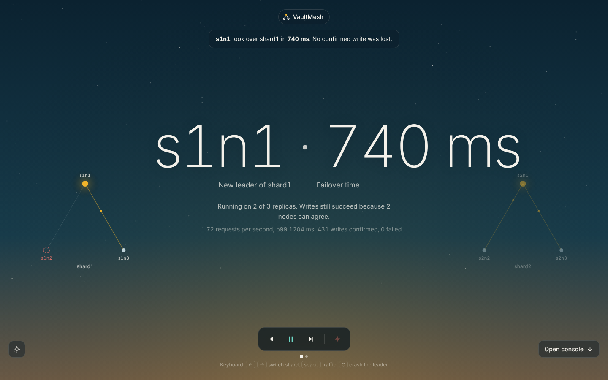
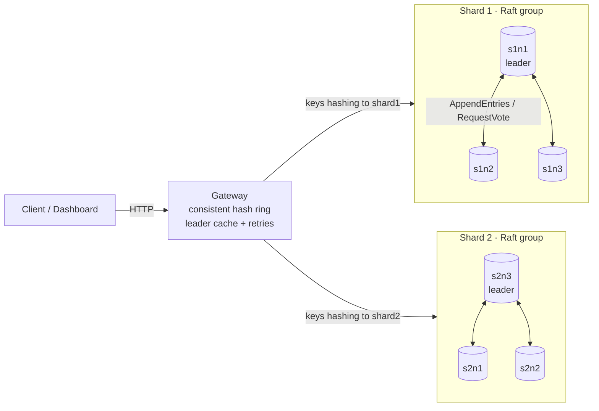

# VaultMesh — a sharded, fault-tolerant key-value store built on Raft


**Live demo:** _coming soon_ · **Author:** [Mahendra Meena](https://github.com/Mahendr99ar)

VaultMesh is a distributed key-value database written from scratch in Python. Data is split across
**shards** with consistent hashing, and every shard is replicated on **three nodes** that agree on
every write through the **Raft consensus algorithm**. Any single node can crash — including the
leader — and the cluster keeps serving reads and writes without losing a single acknowledged write.





## Features

| Area | What is implemented |
|---|---|
| Consensus | Raft leader election (randomised timeouts, up-to-date-log vote rule), log replication with consistency check, conflict truncation and fast back-off, majority commit, leader no-op on election |
| Storage | Append-only write-ahead log with CRC32 per record, `fsync` before acknowledging, torn-write recovery on startup; term/vote persisted with write-temp-fsync-rename |
| Performance | Group commit (one `fsync` per batch of concurrent writes), one in-flight RPC per follower with coalescing, pooled keep-alive HTTP connections |
| Consistency | Linearizable reads through the **ReadIndex** protocol (no log write per read); optional fast `?consistency=stale` local reads |
| Sharding | Consistent hash ring with 128 virtual nodes per shard; adding a shard moves ~1/N of keys |
| Routing | Gateway caches each shard's leader, follows `X-Raft-Leader` redirects, retries other replicas with exponential backoff |
| Operations | Live console: animated Raft topology per shard, one-click "crash leader" with measured failover time, browser load generator with throughput/p99 chart, event timeline, interactive hash ring. `/status`, `/cluster`, Docker Compose, GitHub Actions CI |
| Testing | 22 pytest tests incl. partitions, leader isolation and crash recovery on a simulated network, plus a chaos test that SIGKILLs leaders on a real cluster |

## Results

Measured on a single 2-vCPU Linux VM running all 7 processes (6 nodes + gateway) **and** the load
generator, with `fsync` on every write — so these are conservative numbers.

| Test | Result |
|---|---|
| Writes (10,000 PUTs, 64 concurrent clients) | **1,397 ops/sec**, p50 41.7 ms, p99 92.9 ms, 0 errors |
| Linearizable reads (ReadIndex) | **1,560 ops/sec**, p99 64.2 ms |
| Stale local reads | **2,359 ops/sec**, p99 52.8 ms |
| Chaos test: 5 leader SIGKILLs during live writes | **0 of 10,153** acknowledged writes lost |
| Failover (leader killed → writes succeed again) | **653 ms average** (436–717 ms) |
| HTTP client profiling fix (httpx → aiohttp) | **~9×** write throughput (≈160 → 1,397 ops/sec) |

## Quick start

Requires Python 3.10+.

```bash
pip install -r requirements-dev.txt
python -m pytest -v                          # 22 tests

python scripts/local_cluster.py --clean      # 2 shards x 3 nodes + gateway
# open http://localhost:8080  for the live dashboard
```

In a second terminal:

```bash
curl -X PUT localhost:8080/kv/user:42 -H "content-type: application/json" -d '{"value":"Mahendra"}'
curl localhost:8080/kv/user:42
python scripts/chaos_test.py --rounds 3       # kill leaders under load, verify no data loss
python -m vaultmesh bench --ops 10000 --concurrency 64
```

With Docker: `docker compose up -d --build`, then open http://localhost:8080.

## API

| Method | Path | Description |
|---|---|---|
| `PUT` | `/kv/{key}` | body `{"value": "..."}`; returns after the write is committed on a majority |
| `GET` | `/kv/{key}` | linearizable read; add `?consistency=stale` for a fast local read |
| `DELETE` | `/kv/{key}` | delete a key |
| `GET` | `/ring/{key}` | which shard and nodes own a key |
| `GET` | `/cluster` | role, term, commit index and log size of every node |
| `GET` | `/ring-map` | every virtual node on the hash ring (used by the console) |
| `POST` | `/admin/crash` | body `{"shard": "shard1", "seconds": 4}`; simulates a crash of that shard's leader. Refused unless all 3 replicas are healthy, so a shard never loses its majority |
| `GET` | `/` | live console |

Gateway responses carry `X-Shard`, `X-Served-By` and `X-Attempts` headers so you can watch
routing and failover happen.

## Project structure

```
vaultmesh/
  wal.py          write-ahead log: CRC32 records, fsync, torn-write recovery
  state.py        durable currentTerm / votedFor (atomic rename)
  messages.py     RequestVote and AppendEntries messages
  raft.py         the Raft node: election, replication, commit, group commit, ReadIndex
  transport.py    node-to-node RPC over HTTP (aiohttp)
  kv.py           key-value state machine and command encoding
  node_server.py  FastAPI server for one node
  ring.py         consistent hash ring with virtual nodes
  gateway.py      router: sharding, leader discovery, retries, /cluster
  bench.py        load generator (throughput, p50/p95/p99)
  static/         dashboard
scripts/
  local_cluster.py  run the whole cluster on one machine
  chaos_test.py     kill leaders under load and verify no acknowledged write is lost
tests/            pytest suite with an in-memory network that can partition nodes
```

## Design decisions

* **Single-threaded event loop per node.** All Raft state lives on one asyncio loop and is only
  changed in non-`async` methods, so there are no locks and no data races. Network replies are
  checked against the current term, so late or duplicated replies are ignored.
* **Commit only current-term entries.** A new leader appends a no-op and only counts replicas
  for entries from its own term (Raft §5.4.2), which prevents the "Figure 8" anomaly.
* **ReadIndex instead of logging reads.** A read records the commit index, confirms leadership
  with a heartbeat round acknowledged by a majority, then waits for the state machine to catch
  up. An isolated old leader therefore refuses strong reads instead of returning stale data.
* **Group commit.** Writes arriving in the same event-loop tick share a single `fsync`.

## Limitations and next steps

* No log compaction or snapshots yet; the WAL grows forever and a restarted node replays it.
* Cluster membership is static (no joint consensus); shards are fixed at start-up.
* No authentication; run it on a private network or behind a reverse proxy.

## Reference

Diego Ongaro and John Ousterhout, *In Search of an Understandable Consensus Algorithm*, USENIX ATC 2014.
